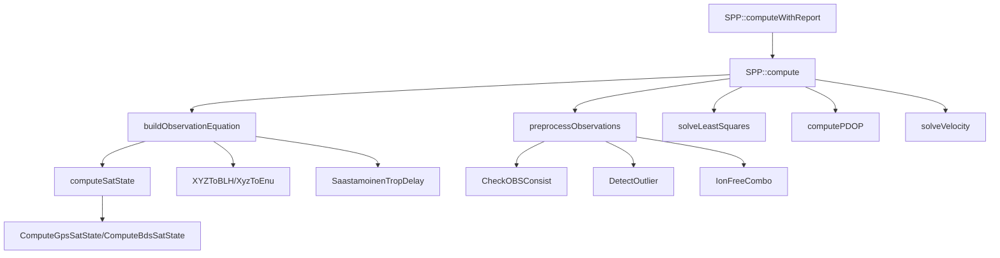

# GNSS 单点定位（SPP）模块技术文档（函数级展开）

> 适用范围：本仓库 `d:\gnss_positioning` 的 SPP 定位流水线（NovAtel OEM 解码 → 星历/观测组织 → SPP 最小二乘定位 + RAIM 剔除 + 多普勒测速）。  
> 代码交叉引用使用 `file:///` 形式，可在支持的 IDE/插件中直接跳转。

## 目录

- [1. 目录映射](#1-目录映射)
- [2. 模块边界与职责](#2-模块边界与职责)
- [3. 关键数据结构（含内存布局/对齐/生命周期）](#3-关键数据结构含内存布局对齐生命周期)
- [4. 宏/硬件加速要素扫描](#4-宏硬件加速要素扫描)
- [5. 执行链路：初始化→资源→并发→异常→日志](#5-执行链路初始化资源并发异常日志)
- [6. SPP 模块函数级说明（SPP.h / SPP.cpp）](#6-spp-模块函数级说明spph--sppcpp)
- [7. 依赖模块函数级说明（SatPosCalc / ErrorCorrection / NavMath / NovatelDecoder）](#7-依赖模块函数级说明satposcalc--errorcorrection--navmath--novateldecoder)
- [8. 可复现与扩展指南（含 diff 高亮示例）](#8-可复现与扩展指南含-diff-高亮示例)

---

## 1. 目录映射

### 1.1 SPP“核心模块”文件

- 头文件：[SPP.h](file:///d:/gnss_positioning/include/gnss_positioning/SPP.h)
- 实现文件：[SPP.cpp](file:///d:/gnss_positioning/src/SPP.cpp)

### 1.2 SPP“计算依赖”文件（被 SPP 直接调用）

- 广播星历卫星状态计算：[SatPosCalc.h](file:///d:/gnss_positioning/include/gnss_positioning/SatPosCalc.h), [SatPosCalc.cpp](file:///d:/gnss_positioning/src/SatPosCalc.cpp)
- 误差改正/组合（本工程 SPP 当前主要用 Saastamoinen + 无电离层组合）：[ErrorCorrection.h](file:///d:/gnss_positioning/include/gnss_positioning/ErrorCorrection.h), [ErrorCorrection.cpp](file:///d:/gnss_positioning/src/ErrorCorrection.cpp)
- 坐标/时间基础数学（SPP 用到 XYZToBLH / XyzToEnu）：[NavMath.h](file:///d:/gnss_positioning/include/gnss_positioning/NavMath.h), [NavMath.cpp](file:///d:/gnss_positioning/src/NavMath.cpp)

### 1.3 SPP“数据入口依赖”文件（提供 ObsData / Ephem 原始结构）

- NovAtel OEM 解码与观测/星历结构定义：[NovatelDecoder.h](file:///d:/gnss_positioning/include/gnss_positioning/NovatelDecoder.h), [NovatelDecoder.cpp](file:///d:/gnss_positioning/src/NovatelDecoder.cpp)

### 1.4 应用层驱动/配置（决定初始化与输出链路）

- 主程序与运行时配置/落盘：[main.cpp](file:///d:/gnss_positioning/src/main.cpp)

### 1.5 单元测试与仓库内配置

- 单元测试：仓库内未发现 `test/`、`*_test.*` 等文件（目录扫描结果为空）。
- 配置文件：仓库内未提供默认 `*.ini/*.json/*.yaml`。运行时配置文件是**外部可选** key=value 文本（由 `--config=` 指定），读取逻辑在 [main.cpp](file:///d:/gnss_positioning/src/main.cpp) 的 `ConfigManager::loadFromFile()`。

---

## 2. 模块边界与职责

### 2.1 SPP（定位模块）输入/输出契约

- 输入
  - `t_rx_gpst`：接收时刻（GPST 周内秒）
  - `obsList`：同一历元观测（NovAtel RANGE 解码后得到的 `ObsData` 列表）
  - `ephList`：统一格式 `Ephemeris` 列表（由 `ConvertFromGpsEphem/ConvertFromBdsEphem` 转换）
- 输出
  - `bool ok`：是否成功解算
  - `SppSolution sol_`：内部保存的最近一次解（ECEF 坐标、钟差、BDS-ISB、PDOP、sigma0、测速/钟漂等）
  - `SppEpochReport`：工程落盘/诊断报告（由 `computeWithReport` 填充）

### 2.2 本工程 SPP 采用的观测方程与状态

在 [SPP.cpp](file:///d:/gnss_positioning/src/SPP.cpp#L421-L524) 中构建的伪距模型（工程实现形式）：

- 观测侧修正：`P_corr = P + c*dt_s`（若非无电离层组合，再对卫星钟差应用 `-tgd`）
- 预测侧：`rho + tropo + (c*dt_r) (+ ISB_BDS)`
- 残差：`v = P_corr - (rho + tropo + bias_m)`

状态向量维度：
- GPS-only：`[X,Y,Z, clk_gps_m]^T`（4 维）
- GPS+BDS：`[X,Y,Z, clk_gps_m, isb_bds_m]^T`（5 维）

---

## 3. 关键数据结构（含内存布局/对齐/生命周期）

> 说明：下面“内存布局/大小”以常见 64-bit Windows ABI（double 按 8 字节对齐、enum class 底层 int）为**典型情况**推导；最终以实际编译器/编译选项为准。

### 3.1 SPP 模块核心结构

#### 3.1.1 `gnss::SppConst`（常量集合）
- 定义：[SPP.h](file:///d:/gnss_positioning/include/gnss_positioning/SPP.h#L24-L38)
- 生命周期：静态常量（编译期）。
- 内存：无实例字段（仅 `static constexpr`）。

#### 3.1.2 `gnss::Ephemeris`（统一星历）
- 定义：[SPP.h](file:///d:/gnss_positioning/include/gnss_positioning/SPP.h#L44-L65)
- 字段语义（摘要）
  - `system/prn`：系统与卫星号
  - `toe/toc`：周内秒（注意：GPS=GPST；BDS=BDT，SPP 内部对周内秒做环绕归一化）
  - `af0/af1/af2`：钟差多项式
  - `tgd`：群延迟（GPS:TGD；BDS:TGD1）
  - `rootA,ecc,inc0,...`：广播星历轨道根数与摄动项
- 典型内存布局（偏移/大小）
  - `system`(4) + `prn`(4) → 8
  - 后续全部 `double` 顺序排列至 `cis`，典型总大小约 **184 bytes**，对齐 8。
- 生命周期
  - main 层：`eph_store`（`std::map`）缓存，贯穿程序运行并被新电文覆盖（见 [main.cpp](file:///d:/gnss_positioning/src/main.cpp#L955-L1051)）。
  - 传入 SPP：以 `std::vector<Ephemeris>` 形式按历元复制/组装。

#### 3.1.3 `gnss::SppSolution`（定位解）
- 定义：[SPP.h](file:///d:/gnss_positioning/include/gnss_positioning/SPP.h#L70-L83)
- 字段语义：ECEF 坐标、GPS 钟差（米）、BDS-ISB（米）、测速（ECEF m/s）、钟漂（m/s）、PDOP、sigma0、使用卫星数统计。
- 典型内存布局：约 **104 bytes**，对齐 8（含末尾 padding）。

#### 3.1.4 `gnss::SppEpochReport`（单历元报告）
- 定义：[SPP.h](file:///d:/gnss_positioning/include/gnss_positioning/SPP.h#L89-L110)
- 用途：主程序落盘/诊断用，避免 main 承担定位逻辑判断。
- 典型内存布局：约 **144 bytes**（bool 引入 padding），对齐 8。
- 生命周期：main 循环内栈变量，每历元生成一次（见 [main.cpp](file:///d:/gnss_positioning/src/main.cpp#L1061-L1074)）。

#### 3.1.5 `gnss::SPP`（解算器类）
- 定义：[SPP.h](file:///d:/gnss_positioning/include/gnss_positioning/SPP.h#L135-L395)
- 关键成员
  - `SppSolution sol_`：最近解（跨历元持久）
  - `mutable double current_tow_gpst_`：当前历元时刻（供 `DetectOutlier` 使用）
  - `mutable std::map<uint32_t, PrevGf> prev_gf_`：GF 历元间粗差检测状态（跨历元持久）
  - `max_iter_, conv_m_, elev_mask_deg_, snr_mask_dbhz_, enable_iono_free_, verbose_`：运行参数
- 生命周期
  - 通常由应用层持有一个实例贯穿程序运行（见 [main.cpp](file:///d:/gnss_positioning/src/main.cpp#L770-L806) 的 `SppCore`）。

### 3.2 SPP 依赖结构（SPP 流水线必须理解）

#### 3.2.1 `gnss::ObsData`（观测）
- 定义：[NovatelDecoder.h](file:///d:/gnss_positioning/include/gnss_positioning/NovatelDecoder.h#L38-L47)
- 典型内存布局：约 **40 bytes**，对齐 8。
- 生命周期：解码器内部 `std::vector<ObsData> obsList_` 缓存，每帧 RANGE 解码时重建（见 [NovatelDecoder.cpp](file:///d:/gnss_positioning/src/NovatelDecoder.cpp#L121-L159)）。

#### 3.2.2 `gnss::SatState`（卫星状态）
- 定义：[SatPosCalc.h](file:///d:/gnss_positioning/include/gnss_positioning/SatPosCalc.h#L101-L108)
- 内容：ECEF 位置/速度、钟差/钟速、有效性与星历过期标志。
- 生命周期：SPP 内部 `computeSatState` 栈上变量；或 main 的卫星状态输出链路中栈上变量（见 [main.cpp](file:///d:/gnss_positioning/src/main.cpp#L1045-L1049)）。

---

## 4. 宏/硬件加速要素扫描

### 4.1 宏（#define）与编译条件

- include guard：各头文件均使用 `#ifndef/#define/#endif`（例如 [SPP.h](file:///d:/gnss_positioning/include/gnss_positioning/SPP.h#L8-L9)）。
- `M_PI` 兼容宏：
  - [SPP.cpp](file:///d:/gnss_positioning/src/SPP.cpp#L18-L21)
  - [NavMath.cpp](file:///d:/gnss_positioning/src/NavMath.cpp#L14-L17)
- `_USE_MATH_DEFINES`：
  - [NavMath.h](file:///d:/gnss_positioning/include/gnss_positioning/NavMath.h#L13-L15)
  - [NavMath.cpp](file:///d:/gnss_positioning/src/NavMath.cpp#L10)

### 4.2 内联汇编 / SIMD / CUDA

- 代码库内未发现 `asm/__asm`、SSE/AVX intrinsic、CUDA kernel（全局扫描无匹配）。
- Eigen 用于线性代数（QR/LDLT），但当前代码未显式使用 SIMD intrinsic；是否启用向量化由 Eigen 编译选项决定（属于编译期优化，不是源码级硬件加速逻辑）。

---

## 5. 执行链路：初始化→资源→并发→异常→日志

### 5.1 初始化链路（应用层 → SPP）

1. main 解析参数/可选配置文件（`ConfigManager`）：[main.cpp](file:///d:/gnss_positioning/src/main.cpp#L250-L387)
2. main 构造 `SppCore` 并注入运行参数（elev/snr/iono-free）：[main.cpp](file:///d:/gnss_positioning/src/main.cpp#L770-L806)
3. main 读取二进制日志，解码 RANGE 与星历，构造 `eph_list` 调用：
   - `SPP::computeWithReport()` via `SppCore::compute()`：[main.cpp](file:///d:/gnss_positioning/src/main.cpp#L1061-L1064)

### 5.2 资源申请与释放

- SPP 本身不持有文件句柄/线程/系统资源；主要资源是容器与 Eigen 矩阵的动态分配：
  - `preprocessObservations` 内部 `std::map` / `std::vector`；
  - `solveLeastSquares/solveVelocity/computePDOP` 内部 `Eigen::MatrixXd/VectorXd`。
- 资源释放依赖 RAII（函数退出自动释放），跨历元持久状态仅 `prev_gf_` 与 `sol_`。

### 5.3 并发控制

- SPP 类**非线程安全**：
  - `compute()` 会更新 `sol_`、`current_tow_gpst_`、`prev_gf_`（其中 `prev_gf_` 通过 `mutable` 在 `const` 方法中被写入：[SPP.h](file:///d:/gnss_positioning/include/gnss_positioning/SPP.h#L383-L389)，实现见 [SPP.cpp](file:///d:/gnss_positioning/src/SPP.cpp#L309-L335)）。
- 推荐并发模型
  - 每线程独立持有一个 `SPP` 实例；或外部用 mutex 串行化 `compute()` 调用。

### 5.4 异常处理策略

- SPP 内部：以 `bool` 返回值与 `std::isfinite` 检查为主，不抛异常（见多处 early-return，如 [SPP.cpp](file:///d:/gnss_positioning/src/SPP.cpp#L303-L307), [SPP.cpp](file:///d:/gnss_positioning/src/SPP.cpp#L344-L419)）。
- 应用层 main：顶层 `try/catch(std::exception)` 捕获配置解析与 I/O 异常（见 [main.cpp](file:///d:/gnss_positioning/src/main.cpp#L928-L1118)）。

### 5.5 日志追踪链路

- SPP 内部调试输出：`verbose_` 开关，使用 `std::cout` 输出每星/每迭代信息（见 [SPP.cpp](file:///d:/gnss_positioning/src/SPP.cpp#L512-L520), [SPP.cpp](file:///d:/gnss_positioning/src/SPP.cpp#L726-L754)）。
- 应用层终端摘要输出：`TerminalOutput`（见 [main.cpp](file:///d:/gnss_positioning/src/main.cpp#L389-L488)）。
- 文件落盘：`FileManager` 统一输出 `spp_solution.txt / sat_states.txt / gps_ephem.txt / bds_ephem.txt / range_obs.txt`（见 [main.cpp](file:///d:/gnss_positioning/src/main.cpp#L497-L761)）。

---

## 6. SPP 模块函数级说明（SPP.h / SPP.cpp）

### 6.1 调用关系总览（SPP 内部）



---

### 6.2 文件内“自由函数”（非成员函数）

#### 6.2.1 `gnss::Ephemeris ConvertFromGpsEphem(const GpsEphem& gps_eph)`
- 定义：[SPP.h](file:///d:/gnss_positioning/include/gnss_positioning/SPP.h#L117-L124)，实现：[SPP.cpp](file:///d:/gnss_positioning/src/SPP.cpp#L96-L123)
- 输入：NovAtel 解码得到的 `GpsEphem`
- 输出：统一 `Ephemeris`（`system=GPS`，`rootA=sqrt(majaxis)`）
- 调用关系
  - Called by：main 写入/缓存星历时（见 [main.cpp](file:///d:/gnss_positioning/src/main.cpp#L992-L999)）
  - Calls：`std::sqrt`
- 核心流程
  1. 字段搬运
  2. 半长轴：`rootA = sqrt(A)`
- 复杂度：时间 O(1)，空间 O(1)

#### 6.2.2 `gnss::Ephemeris ConvertFromBdsEphem(const BdsEphem& bds_eph)`
- 定义：[SPP.h](file:///d:/gnss_positioning/include/gnss_positioning/SPP.h#L124-L125)，实现：[SPP.cpp](file:///d:/gnss_positioning/src/SPP.cpp#L125-L154)
- 输入：`BdsEphem`
- 输出：统一 `Ephemeris`（`system=BDS`，`tgd=tgd1`，`rootA` 已是 sqrt(A)）
- 调用关系
  - Called by：main 写入/缓存星历（见 [main.cpp](file:///d:/gnss_positioning/src/main.cpp#L1004-L1010)）
- 复杂度：时间 O(1)，空间 O(1)

---

### 6.3 `gnss::SPP` 公有接口（API）

#### 6.3.1 `SPP::SPP()`
- 定义：[SPP.h](file:///d:/gnss_positioning/include/gnss_positioning/SPP.h#L141)，实现：[SPP.cpp](file:///d:/gnss_positioning/src/SPP.cpp#L156-L162)
- 输入/输出：无
- 副作用：初始化默认参数与解状态（`enable_iono_free_=true`，mask 默认 10°/30dBHz）
- 复杂度：O(1)

#### 6.3.2 `bool SPP::compute(double t_rx_gpst, const std::vector<ObsData>& obsList, const std::vector<Ephemeris>& ephList)`
- 定义：[SPP.h](file:///d:/gnss_positioning/include/gnss_positioning/SPP.h#L150)，实现：[SPP.cpp](file:///d:/gnss_positioning/src/SPP.cpp#L657-L853)
- 输入
  - `t_rx_gpst`：接收时刻（GPST 周内秒）
  - `obsList`：观测列表（同历元）
  - `ephList`：星历列表（多系统混合）
- 输出
  - 返回 `true/false`
  - 更新 `sol_`：位置/钟差/ISB/PDOP/sigma0/测速等
- 调用关系（直接调用）
  - Calls：`preprocessObservations`、`buildObservationEquation`、`solveLeastSquares`、`computePDOP`、`solveVelocity`
- 核心算法流程（逐步）
  1. 重置本历元统计与输出字段（reject/pdop/sigma0/vel 等）。
  2. 设置 `current_tow_gpst_ = t_rx_gpst`，供 GF 历元间差分使用。
  3. 观测预处理：聚合/掩码/无电离层组合/粗差标记（`procObs`）。
  4. 若可用观测（非 gf_outlier）少于 4 → fail。
  5. 初始化迭代初值：若历史 `sol_.pos` 无效（模长≤1）则从 0 开始。
  6. RAIM 外层最多 3 次（`kRaimMaxIter`）：每次最多剔除 1 颗最大残差卫星（按伪距残差阈值 `kRaimSigmaFactor*kRaimPseudorangeSigmaM`）。
  7. 每个 RAIM 轮次内：最小二乘迭代最多 10 次
     - 使用当前钟差得到“真接收时刻” `t_rx_true = t_rx_gpst - clk_gps_m/c`
     - 构建卫星中间量与观测方程（含高度角筛选/对流层/钟差处理）
     - 形成加权最小二乘并求解 dx（QR）
     - 更新状态（4维或5维）
     - 若位置增量平方 `dpos2 < 1e-6`（≈ 1mm 收敛阈值）则收敛
  8. 收敛后：若最大绝对残差 > RAIM 阈值且仍满足最少卫星数（GPS-only≥4，GPS+BDS≥5），则标记该星为 rejected 并重来。
  9. 输出：`sigma0`（加权残差 RMS / dof）、`PDOP`（由 `H^T H` 求逆）、使用卫星数统计。
  10. 若存在足够多普勒观测，解算测速与钟漂（`solveVelocity`）。
- 时间复杂度（每历元）
  - 设 `Nobs`=观测条数、`Nsat`=本历元可用卫星数、`Neph`=星历条数。
  - `preprocessObservations`：O(Nobs log Nsat)
  - `buildObservationEquation`：O(Neph log Neph + Nsat log Neph)
  - `solveLeastSquares`：n≤5，QR 近似 O(Nsat)（常数维度）
  - 迭代次数上限：RAIM≤3，LS≤10 → 常数倍
  - 总体：**O((Nobs+Neph+Nsat) log Neph)**（在本工程规模上近似线性）
- 空间复杂度
  - 主要为 `procObs/sats` 向量与 `Eigen` 矩阵：O(Nsat)

#### 6.3.3 `bool SPP::computeWithReport(..., SppEpochReport& report)`
- 定义：[SPP.h](file:///d:/gnss_positioning/include/gnss_positioning/SPP.h#L160)，实现：[SPP.cpp](file:///d:/gnss_positioning/src/SPP.cpp#L855-L945)
- 作用：在不改变定位算法的前提下，补齐工程诊断字段（观测数、星历数、匹配数、是否 attempted 等）
- 关键判定
  - 若 `ephTotal==0` → `attempted=false`
  - 若匹配数不足（matchTotal < (match_b>0?5:4)）→ `attempted=false`
  - 否则 `attempted=true` 并调用 `compute`
- 复杂度：构建 map/set 引入 O(Nobs log Nobs + Neph log Neph)，其余同 `compute`

#### 6.3.4 `std::vector<double> SPP::getPosition() const`
- 定义：[SPP.h](file:///d:/gnss_positioning/include/gnss_positioning/SPP.h#L166)，实现：[SPP.cpp](file:///d:/gnss_positioning/src/SPP.cpp#L164-L166)
- 输出：`{X,Y,Z}`
- 复杂度：O(1)

#### 6.3.5 `double SPP::getReceiverClockBias() const`
- 定义：[SPP.h](file:///d:/gnss_positioning/include/gnss_positioning/SPP.h#L171)，实现：[SPP.cpp](file:///d:/gnss_positioning/src/SPP.cpp#L168-L170)
- 输出：`clk_gps_m`
- 复杂度：O(1)

#### 6.3.6 参数/开关类内联方法
- 定义：[SPP.h](file:///d:/gnss_positioning/include/gnss_positioning/SPP.h#L176-L201)
  - `setVerbose(bool)`
  - `setElevationMaskDeg(double)`
  - `setSnrMaskDbHz(double)`
  - `setEnableIonoFree(bool)`
  - `getBdsIsbMeters() const`
- 复杂度：O(1)

---

### 6.4 `gnss::SPP` 私有方法（关键算法单元）

#### 6.4.1 `static double SPP::normalizeTimeSec(double dt)`
- 定义：[SPP.h](file:///d:/gnss_positioning/include/gnss_positioning/SPP.h#L250)，实现：[SPP.cpp](file:///d:/gnss_positioning/src/SPP.cpp#L172-L177)
- 输入：时间差 dt（秒）
- 输出：归一化到 `[-302400, +302400]`（半周），避免跨周跳变
- 复杂度：O(1)

#### 6.4.2 `static uint32_t SPP::makeKey(GnssSystem sys, uint32_t prn)`
- 定义：[SPP.h](file:///d:/gnss_positioning/include/gnss_positioning/SPP.h#L257)，实现：[SPP.cpp](file:///d:/gnss_positioning/src/SPP.cpp#L179-L181)
- 输出：`sys*1000 + prn`（工程约定键）
- 复杂度：O(1)

#### 6.4.3 `Ephemeris SPP::normalizeEphemerisToGpSt(const Ephemeris& eph) const`
- 定义：[SPP.h](file:///d:/gnss_positioning/include/gnss_positioning/SPP.h#L264)，实现：[SPP.cpp](file:///d:/gnss_positioning/src/SPP.cpp#L183-L188)
- 功能：对 `toe/toc` 做周内秒环绕归一化（注意：此处不做 BDT↔GPST +14s 转换，只做 [0,604800) 归一化）
- 复杂度：O(1)

#### 6.4.4 `std::vector<ProcObs> SPP::preprocessObservations(const std::vector<ObsData>& obsList) const`
- 定义：[SPP.h](file:///d:/gnss_positioning/include/gnss_positioning/SPP.h#L271)，实现：[SPP.cpp](file:///d:/gnss_positioning/src/SPP.cpp#L190-L301)
- 输入：同历元原始观测（可能包含多系统、多频点、同星多通道）
- 输出：每星 1 条 `ProcObs`（用于后续建模）
- 核心策略
  1. 过滤：`pseudorange>0`、`snr>=snr_mask_dbhz_`、`freqIdx in {0,1}`
  2. 聚合：按 `(system,prn)` 分组，同频点保留 **最高 SNR** 的伪距（降低多路径/噪声风险）
  3. IF 策略：若 `enable_iono_free_==true`，则必须同时具备 freq0 与 freq1 且通过一致性检查 `CheckOBSConsist`
  4. GF 粗差：`gf = P0 - P1`，对 `dGF`（与上一历元差分）做阈值检测，超阈值则标记 `gf_outlier=true` 并保留该记录但在后续 `buildObservationEquation` 中跳过
  5. 无电离层组合：按系统选择 `f1/f2`，`P = IonFreeCombo(P0,P1,f1,f2)`，并置 `iono_free=true`
  6. 波长与多普勒：仅对 GPS L1 / BDS B1I 计算 `wavelength`，将 `doppler` 标记为有限值才认为可用
- 调用关系
  - Calls：`CheckOBSConsist`、`DetectOutlier`、`IonFreeCombo`
- 复杂度：时间 O(Nobs log Nsat)，空间 O(Nsat)

#### 6.4.5 `bool SPP::CheckOBSConsist(double P1, double P2) const`
- 定义：[SPP.h](file:///d:/gnss_positioning/include/gnss_positioning/SPP.h#L279)，实现：[SPP.cpp](file:///d:/gnss_positioning/src/SPP.cpp#L303-L307)
- 当前实现：仅检查有限性与正值（不做差值/量级/跳变约束）
- 复杂度：O(1)

#### 6.4.6 `bool SPP::DetectOutlier(GnssSystem sys, uint32_t prn, double gf_m, double& dgf_m) const`
- 定义：[SPP.h](file:///d:/gnss_positioning/include/gnss_positioning/SPP.h#L289)，实现：[SPP.cpp](file:///d:/gnss_positioning/src/SPP.cpp#L309-L335)
- 输入
  - `gf_m`：当前历元 GF（米）
- 输出
  - `dgf_m`：当前与上一历元 GF 差分
  - return：是否判为粗差（true 表示 outlier）
- 状态依赖：读写 `prev_gf_`（跨历元）
- 逻辑
  1. 首次出现该星：记录 `PrevGf{tow,gf}`，不判粗差
  2. 若历元间隔 `|dt| > kGfMaxGapSec`（10s）：重置历史，不判粗差
  3. 否则计算 `dGF`，若 `|dGF| > kGfDgfThresholdM`（2m）判粗差
- 复杂度：O(log Nhist)（map 查找/写入），空间 O(Nhist)

#### 6.4.7 `double SPP::computeTransmitTime(double t_rx_gpst, double pseudorange_m) const`
- 定义：[SPP.h](file:///d:/gnss_positioning/include/gnss_positioning/SPP.h#L297)，实现：[SPP.cpp](file:///d:/gnss_positioning/src/SPP.cpp#L337-L342)
- 功能：初值 `t_tx = t_rx - P/c`（当前工程中更完整传播时间迭代在 `computeSatState` 内完成）
- 复杂度：O(1)

#### 6.4.8 `bool SPP::computeSatState(...) const`
- 定义：[SPP.h](file:///d:/gnss_positioning/include/gnss_positioning/SPP.h#L308)，实现：[SPP.cpp](file:///d:/gnss_positioning/src/SPP.cpp#L344-L419)
- 输入
  - `t_rx_gpst`：接收时刻（通常使用 `t_rx_true`）
  - `pseudorange_m`：用于传播时间初值与迭代
  - `eph`：广播星历（GPS 视为 GPST，BDS 视为 BDT；函数内通过 `gpstToBdtSec()` 适配）
  - `rx_pos_approx`：接收机近似位置（用于几何距离迭代）
  - `proc`：预处理观测（包含是否 iono-free、多普勒与波长）
- 输出：`SatCalc` 中填充 `pos_ecef/vel_ecef/clk_s/clk_drift_s/doppler_ms/has_doppler`
- 核心算法流程
  1. 初始化传播时间 `dt = P/c`
  2. 迭代 3 次：
     - 计算 `t_tx = t_rx - dt`
     - 用广播星历计算卫星状态 `st`（GPS 或 BDS）
     - 用卫星钟差修正发射时刻 `t_tx_corr = t_tx - st.clk_s`
     - 再算一次 `st_corr`（更一致的卫星位置/钟差）
     - 用 `rx_pos_approx` 与 `st_corr.pos` 计算几何距离 `rho`，更新 `dt = rho/c`，若收敛则停止
  3. 地球自转（Sagnac）近似修正：绕 z 轴旋转角 `theta=omega_e*dt`，旋转卫星位置与速度
  4. 钟差处理：`clk_s = st_corr.clk_s`；若非无电离层组合则 `clk_s -= eph.tgd`
  5. 多普勒：若有效则 `doppler_ms = -doppler_hz * wavelength`
- 复杂度：O(1)（常数次卫星状态计算；每次状态计算内部 Kepler 迭代也是常数上限）

#### 6.4.9 `bool SPP::buildObservationEquation(...) const`
- 定义：[SPP.h](file:///d:/gnss_positioning/include/gnss_positioning/SPP.h#L325)，实现：[SPP.cpp](file:///d:/gnss_positioning/src/SPP.cpp#L421-L524)
- 目标：为每颗卫星形成最小二乘所需的中间量 `SatCalc`（LOS、rho、tropo、P_corr、elev/az 等）
- 核心流程
  1. 建 `ephMap(key→Ephemeris)`（按 sys/prn 覆盖式插入）
  2. 由 `rx_pos` 得 `rx_blh`（`XYZToBLH`），用于 ENU 与对流层模型；若失败则降级（elev 设为 90°，tropo=0）
  3. 对每条 `ProcObs`：
     - 若 `gf_outlier` → continue
     - 查星历，调用 `computeSatState`
     - 计算 LOS 与 `rho`
     - 若可计算 ENU：由 `XyzToEnu` 得 elev/az，并施加高度角掩码
     - `tropo = SaastamoinenTropDelay(lat,h,elev)`（仅 rx_geo_ok）
     - `P_corr = P + c*dt_s`
     - 残差预拟合 `prefit = P_corr - (rho+tropo+bias)`（用于 verbose 输出）
     - 填充 `SatCalc` 并置 `valid=true`
- 复杂度：O(Neph log Neph + Nsat log Neph)，空间 O(Neph + Nsat)

#### 6.4.10 `bool SPP::solveLeastSquares(const std::vector<SatCalc>& sats, Eigen::VectorXd& dx, Eigen::VectorXd& v, Eigen::MatrixXd& H) const`
- 定义：[SPP.h](file:///d:/gnss_positioning/include/gnss_positioning/SPP.h#L340)，实现：[SPP.cpp](file:///d:/gnss_positioning/src/SPP.cpp#L526-L578)
- 输入：有效卫星中间量 `sats`（要求 `valid=true` 已过滤）
- 输出
  - `dx`：状态增量（4 或 5 维）
  - `v`：后验残差（未加权）
  - `H`：设计矩阵（未加权）
- 设计矩阵与观测向量
  - `y(i) = P_corr - (rho + tropo + bias_m)`
  - `H(i,:) = [-los.x, -los.y, -los.z, 1, (BDS?1:0)]`
- 权：按高度角构造（实现为 `w = (sin(elev)/sigma_zenith)^2`，并对低仰角下限做保护）
- 求解：对加权后的 `A` 使用 `colPivHouseholderQr().solve(b)`
- 复杂度：n≤5，时间近似 O(m)（常数维），空间 O(m)

#### 6.4.11 `bool SPP::solveVelocity(const std::vector<SatCalc>& sats, const XYZ& rx_pos, Eigen::VectorXd& vel_dx) const`
- 定义：[SPP.h](file:///d:/gnss_positioning/include/gnss_positioning/SPP.h#L352)，实现：[SPP.cpp](file:///d:/gnss_positioning/src/SPP.cpp#L580-L626)
- 目标：用多普勒解算 `[Vx,Vy,Vz,c*dt_dot_r]`
- 观测模型（工程实现）
  - `y = doppler_ms - proj_vs + c*clk_drift_s`
  - `proj_vs = ( (sat_pos-rx_pos)·sat_vel ) / rho`
  - `H = [-los.x, -los.y, -los.z, 1]`
- 复杂度：n=4 常数维，时间 O(m)，空间 O(m)

#### 6.4.12 `double SPP::computePDOP(const Eigen::MatrixXd& H) const`
- 定义：[SPP.h](file:///d:/gnss_positioning/include/gnss_positioning/SPP.h#L359)，实现：[SPP.cpp](file:///d:/gnss_positioning/src/SPP.cpp#L628-L637)
- 方法：`Q = (H^T H)^{-1}`，`PDOP = sqrt(Qxx+Qyy+Qzz)`（LDLT 分解）
- 复杂度：n≤5 常数维，时间 O(1)（相对 m 很小），空间 O(n^2)

#### 6.4.13 `int SPP::detectOutliers(std::vector<SatCalc>& sats, const Eigen::VectorXd& v, double sigma0) const`
- 定义：[SPP.h](file:///d:/gnss_positioning/include/gnss_positioning/SPP.h#L368)，实现：[SPP.cpp](file:///d:/gnss_positioning/src/SPP.cpp#L639-L655)
- 当前工程状态：该函数存在但 `compute()` 未调用；实际 RAIM 剔除逻辑在 `compute()` 内部通过“最大残差卫星剔除”实现（见 [SPP.cpp](file:///d:/gnss_positioning/src/SPP.cpp#L804-L827)）。
- 复杂度：O(m)

---

## 7. 依赖模块函数级说明（SatPosCalc / ErrorCorrection / NavMath / NovatelDecoder）

> SPP 维护者通常需要理解：卫星状态解算口径、对流层/组合函数、坐标转换以及观测/星历来源。

### 7.1 SatPosCalc（广播星历卫星位置/钟差）

- 入口函数
  - `bool ComputeGpsSatState(const GpsEph&, double t_gpst, double transit_time_s, SatState&)`  
    定义：[SatPosCalc.h](file:///d:/gnss_positioning/include/gnss_positioning/SatPosCalc.h#L118-L118)，实现：[SatPosCalc.cpp](file:///d:/gnss_positioning/src/SatPosCalc.cpp#L288-L317)
  - `bool ComputeBdsSatState(const BdsEph&, double t_bdt, double transit_time_s, SatState&)`  
    定义：[SatPosCalc.h](file:///d:/gnss_positioning/include/gnss_positioning/SatPosCalc.h#L128-L128)，实现：[SatPosCalc.cpp](file:///d:/gnss_positioning/src/SatPosCalc.cpp#L319-L369)

- 核心算法摘要
  - Kepler 方程牛顿迭代（`kKeplerMaxIter=30`）：[SatPosCalc.cpp](file:///d:/gnss_positioning/src/SatPosCalc.cpp#L74-L93)
  - 二阶谐波摄动改正（`cuc/cus/...`）与解析速度：  
    `ComputeOrbitalPlaneAnalytical` + `ComputeEcefFromOrbitalPlane`  
    见 [SatPosCalc.cpp](file:///d:/gnss_positioning/src/SatPosCalc.cpp#L106-L216)
  - 卫星钟差/钟速（含相对论项 `F*e*sqrtA*sinE`）：[SatPosCalc.cpp](file:///d:/gnss_positioning/src/SatPosCalc.cpp#L239-L284)
  - BDS GEO 特殊处理（倾角 5° + 地固旋转）：[SatPosCalc.cpp](file:///d:/gnss_positioning/src/SatPosCalc.cpp#L339-L363)

- 复杂度
  - 每次状态计算为常数时间：O(1)（Kepler 迭代上限固定），空间 O(1)

### 7.2 ErrorCorrection（对流层/电离层/组合）

- `double SaastamoinenTropDelay(double lat, double H, double E, ...)`  
  定义：[ErrorCorrection.h](file:///d:/gnss_positioning/include/gnss_positioning/ErrorCorrection.h#L54-L55)，实现：[ErrorCorrection.cpp](file:///d:/gnss_positioning/src/ErrorCorrection.cpp#L126-L155)  
  SPP 当前在 `buildObservationEquation` 使用它（见 [SPP.cpp](file:///d:/gnss_positioning/src/SPP.cpp#L489-L493)）。

- `double IonFreeCombo(double P1, double P2, double f1, double f2)`  
  定义：[ErrorCorrection.h](file:///d:/gnss_positioning/include/gnss_positioning/ErrorCorrection.h#L98-L99)，实现：[ErrorCorrection.cpp](file:///d:/gnss_positioning/src/ErrorCorrection.cpp#L175-L182)  
  SPP 在预处理阶段构造 IF 伪距（见 [SPP.cpp](file:///d:/gnss_positioning/src/SPP.cpp#L264-L294)）。

- 复杂度：均为 O(1)

### 7.3 NavMath（坐标/时间）

- `int XYZToBLH(const XYZ&, BLH&)`：SPP 用于把接收机近似坐标转成大地坐标（对流层模型/ENU）  
  定义：[NavMath.h](file:///d:/gnss_positioning/include/gnss_positioning/NavMath.h#L145-L145)，实现：[NavMath.cpp](file:///d:/gnss_positioning/src/NavMath.cpp#L206-L239)  
  复杂度：迭代最多 10 次 → O(1)

- `int XyzToEnu(const XYZ& origin, const XYZ& target, double& E, double& N, double& U)`：SPP 用于仰角/方位角计算  
  定义：[NavMath.h](file:///d:/gnss_positioning/include/gnss_positioning/NavMath.h#L156-L156)，实现：[NavMath.cpp](file:///d:/gnss_positioning/src/NavMath.cpp#L250-L270)  
  复杂度：O(1)

### 7.4 NovatelDecoder（OEM 二进制解码）

- `bool NovatelDecoder::inputData(uint8_t byte)`：按状态机同步帧、读取头/载荷/CRC  
  实现：[NovatelDecoder.cpp](file:///d:/gnss_positioning/src/NovatelDecoder.cpp#L39-L101)

- `void decodeRange()`：解析 RANGE(ID=43) 为 `ObsData` 列表  
  实现：[NovatelDecoder.cpp](file:///d:/gnss_positioning/src/NovatelDecoder.cpp#L121-L159)

- `void decodeGpsEphem()` / `void decodeBdsEphem()`：解析星历负载为结构体  
  实现：[NovatelDecoder.cpp](file:///d:/gnss_positioning/src/NovatelDecoder.cpp#L166-L234)

- 复杂度：对每帧负载 O(payload_bytes)，对每条观测 O(1)

---

## 8. 可复现与扩展指南（含 diff 高亮示例）

### 8.1 复现本工程 SPP 输出（最小步骤）

1. 准备 NovAtel OEM 二进制日志（默认路径在 [main.cpp](file:///d:/gnss_positioning/src/main.cpp#L77-L86)）。
2. 运行程序时按需设置：
   - `--input=...`
   - `--outdir=...`
   - `--elev-mask=10.0 --snr-mask=30.0`
   - `--iono-free / --no-iono-free`
3. 输出文件格式由 `FileManager::openAll()` 固定（表头在 [main.cpp](file:///d:/gnss_positioning/src/main.cpp#L509-L566)）。

### 8.2 扩展点（维护者常见需求）

- 新增系统（GLO/GAL）：扩展 `ObsData` 的 system 映射、`Ephemeris` 转换、`computeSatState` 分支与状态维度策略（类似 BDS-ISB）。
- 引入电离层模型：目前 SPP 主要依赖 IF 组合消一阶电离层，单频模式下未建模电离层（可在 `buildObservationEquation` 添加 `iono_m` 项并进残差）。
- 更严格观测一致性：当前 `CheckOBSConsist` 仅做有限/正值，可能放过明显异常双频组合。

### 8.3 diff 颜色标记示例（用于文档交付格式演示）

下面仅演示 Markdown 的 `diff` 高亮写法（不代表当前仓库已应用此变更）：

```diff
diff --git a/src/SPP.cpp b/src/SPP.cpp
@@
-bool SPP::CheckOBSConsist(double P1, double P2) const {
-    if (!std::isfinite(P1) || !std::isfinite(P2)) return false;
-    if (!(P1 > 0.0) || !(P2 > 0.0)) return false;
-    return true;
-}
+bool SPP::CheckOBSConsist(double P1, double P2) const {
+    if (!std::isfinite(P1) || !std::isfinite(P2)) return false;
+    if (!(P1 > 0.0) || !(P2 > 0.0)) return false;
+    // 示例：可加入 |P1-P2| 上限、或相对差阈值、或组合后范围检查
+    return true;
+}
```

---

# 附：SPP 输出字段与含义对照

- `X,Y,Z`：接收机 ECEF（m）
- `CLK_GPS(m)`：`c*dt_r`（米）
- `ISB_BDS(m)`：BDS 相对 GPS 系统间偏差（米）
- `PDOP`：由收敛后设计矩阵 H 计算
- `VEL_*`：多普勒测速 ECEF（m/s）
- `CLK_DRIFT_MS(ms)`：变量名含义为 `m/s`（实现是 `c*dt_dot_r`），落盘表头“ms”可能引发歧义，维护时需统一口径（见 [SPP.h](file:///d:/gnss_positioning/include/gnss_positioning/SPP.h#L75-L77) 与 [main.cpp](file:///d:/gnss_positioning/src/main.cpp#L522-L523)）。