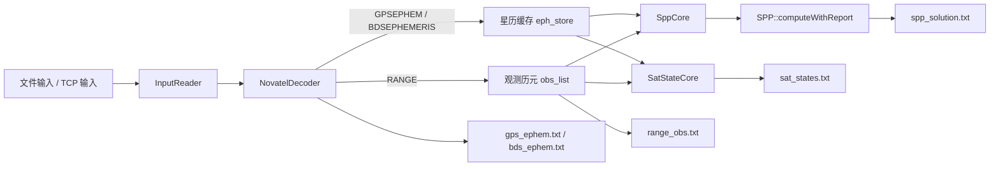

## 项目总体架构

### 模块职责

| 模块 | 代表文件 | 主要职责 |
| --- | --- | --- |
| 配置模块 | `Config.h/.cpp` | 解析 `params.yaml`，检查输入模式、输出开关、SPP 参数和参考坐标是否合法 |
| 输入模块 | `SocketStream.h/.cpp`、`main.cpp` 中的 `InputReader` | 统一封装文件输入和 TCP 输入 |
| 解码模块 | `NovatelDecoder.h/.cpp` | 流式同步 OEM 帧、CRC 校验、按消息 ID 解析观测和星历 |
| 数学基础模块 | `NavMath.h/.cpp` | 提供 GPST/MJD/通用时转换，ECEF/BLH/ENU 转换 |
| 误差改正模块 | `ErrorCorrection.h/.cpp` | 提供 Saastamoinen、Hopfield、Klobuchar、无电离层组合 |
| 卫星状态模块 | `SatPosCalc.h/.cpp` | 基于广播星历计算卫星位置、速度、钟差、钟速 |
| SPP 核心模块 | `SPP.h/.cpp` | 预处理观测、构建观测方程、迭代最小二乘、RAIM、测速、DOP |
| 应用编排模块 | `main.cpp` | 驱动全流程，管理缓存、统计、终端输出与文件输出 |

### 架构图

### 架构特点

- `main.cpp` 只负责“调度和串联”，尽量不直接承载定位公式。
- `SPP.cpp` 只负责“领域算法”，不关心输入来自文件还是网络。
- 星历和观测在应用层汇合，形成“观测驱动、星历支撑”的解算模式。
- 项目既能离线回放，也能面向实时流处理，工程复用性较好。

---