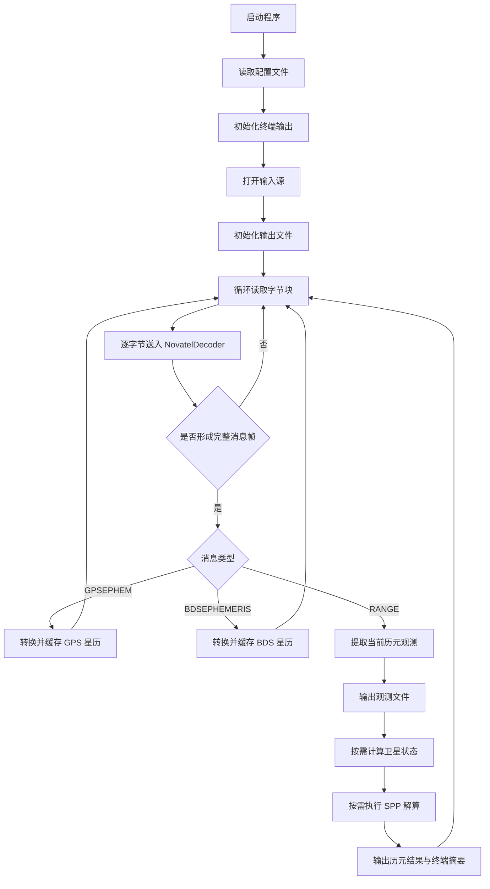

## 主处理流程

### 主流程说明

程序启动后，先加载配置，再打开输入源与输出文件，然后持续读取原始字节流。字节经过 `NovatelDecoder` 解析后分成两类：

- 星历消息：写入缓存，供后续历元复用
- 观测消息：触发卫星状态计算和 SPP 单历元解算

其中最关键的设计点是：

> 不是“定时器”驱动算法，而是“`RANGE` 消息到达”驱动算法。

这样做的好处是，解算时刻和观测时刻天然一致，数据流也更直接。

### 主流程图

### 主程序里值得强调的工程设计

- `InputReader` 统一文件和网络两种输入方式，主循环不需要关心底层差异。
- `eph_store` 使用 `(system, prn)` 作为键，形成长期生效的广播星历缓存。
- `SppCore` 只做参数注入和接口包装，避免 `main.cpp` 直接操作过多算法细节。
- `FileManager` 把落盘逻辑集中起来，保证输出格式固定、职责清晰。
